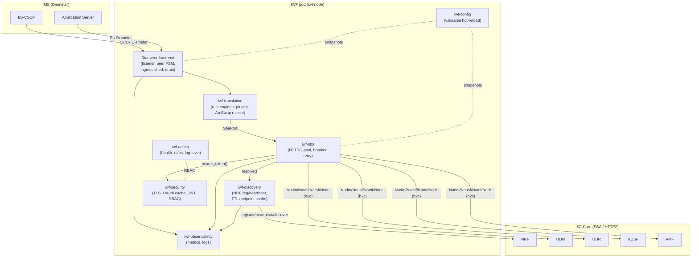
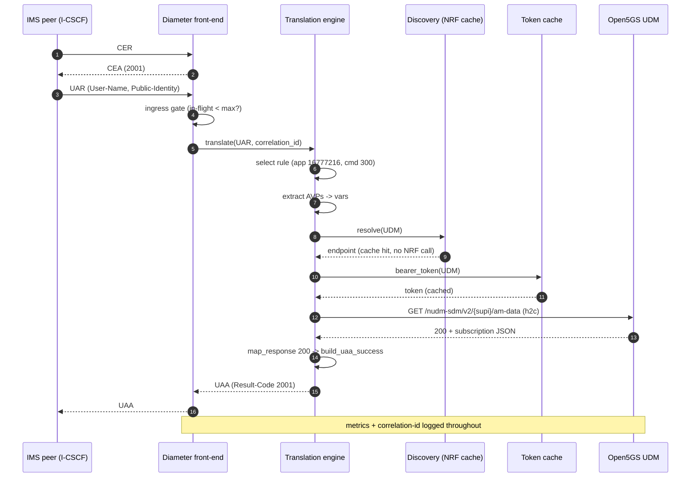
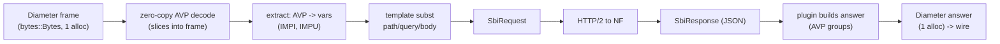
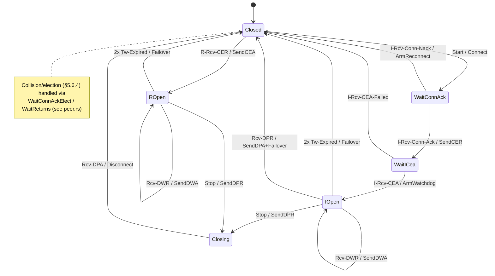
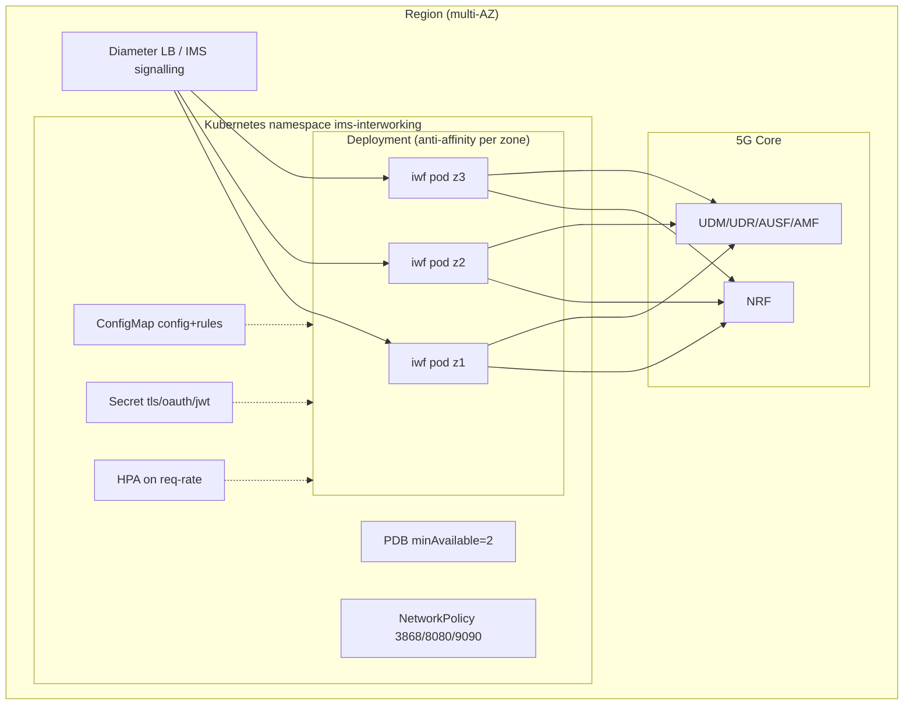
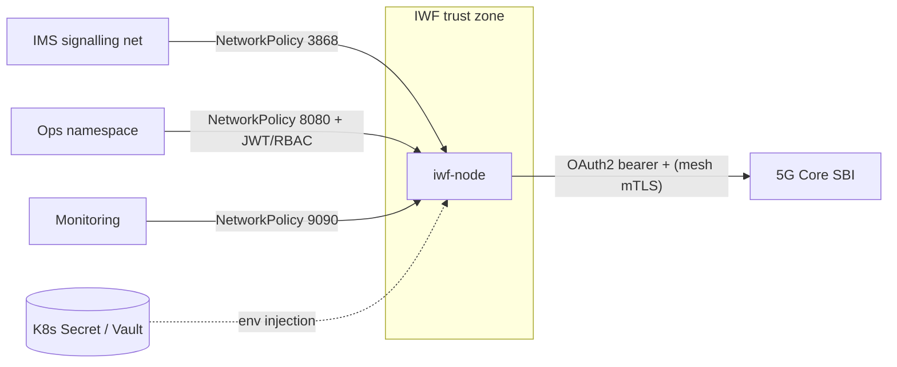

# 2. Architecture (HLD + LLD) — Mermaid

Companion to `docs/hld.md` (prose + failure-mode table) and `docs/lld.md`
(per-crate structure + lock inventory). This document adds the requested
Mermaid diagrams.

## 2.1 Architectural style

- **Hexagonal (ports & adapters)**: `iwf-core` holds domain types + ports
  (`SbaPort`, `EndpointResolver`, `TokenProvider`); adapters live in
  `iwf-sba`, `iwf-discovery`, `iwf-security`. Composition happens only in
  `iwf-node`.
- **Stateless service** (ADR-0004) for horizontal scale.
- **Configuration-driven behaviour** (ADR-0003): translation is data, not code.
- **Pure-core concurrency**: the peer FSM is a pure transition function;
  shared state uses `DashMap`/atomics/`ArcSwap` (lock inventory in `lld.md`).

## 2.2 Component diagram



## 2.3 Request flow — Cx UAR (verified path)



## 2.4 Data flow



## 2.5 Peer FSM state machine (RFC 6733 §5.6 + RFC 3539)



## 2.6 Deployment architecture



Runtime install (bare-metal/VM, FHS layout — `deploy/cdot/`):
```
/opt/CDOT-iwf/{bin,etc,lib,log,run}
  bin/cdot_iwf (start|stop|restart|status), iwf-node, loadgen, tests.sh
```

## 2.7 External dependencies & third-party integrations

| Integration | Direction | Protocol | Notes |
|---|---|---|---|
| IMS peers (I/S-CSCF, AS) | inbound | Diameter/TCP 3868 | terminates Cx/Sh |
| NRF | out | HTTP/2 (h2c) Nnrf | register/heartbeat/discover |
| UDM/UDR/AUSF/AMF | out | HTTP/2 (h2c) | per translation rules |
| OAuth2 AS (often NRF) | out | HTTP/2 | client-credentials tokens |
| Prometheus | inbound scrape | HTTP `:9090` | metrics |
| Admin clients | inbound | HTTP `:8080` + JWT | rules/log-level |
| Service mesh (Istio) | sidecar | mTLS | optional transport security overlay |

## 2.8 Security boundaries



Boundaries: (a) Diameter ingress (network-restricted; no app auth — Diameter
peers are trusted by realm/CER), (b) admin ingress (JWT + RBAC), (c) SBI
egress (OAuth2 + intended mTLS), (d) secrets (never in config files; env /
Secret only).

## 2.9 Cross-cutting strategies (summary; detail in `docs/hld.md`)

- **Config**: `iwf-config` deny-unknown-fields schema, semantic validation,
  inotify hot-reload publishing `Arc<Config>` snapshots.
- **Logging/monitoring**: `tracing` JSON, runtime level via admin API,
  correlation id per transaction, Prometheus families per
  `iwf-observability::metrics`.
- **Scalability**: stateless pods + HPA on `iwf_diameter_requests_total` rate.
- **Reliability**: peer watchdog/failover, circuit breaker, in-transaction
  endpoint failover (<500 ms), validated hot-reload, graceful drain.
- **Performance**: zero-copy codec (≈2 allocs/transaction), HTTP/2
  multiplexed pool, SLO-shaped histograms.

## 2.10 Assumptions & constraints

- Build toolchain pinned for rustc 1.75 (ADR-0005); exact dependency pins.
- 5GC SBI is HTTP/2 cleartext inside the mesh; mTLS mesh-provided today.
- NRF authorizes discovery by requester NF type (deployment-configurable).
- Subscriber data lives in the 5G core (UDM/UDR); the IWF stores none.
